# Các tool VisionPro thường dùng — chi tiết, script mẫu, chuỗi tool nối nhau

> Tài liệu tham khảo cho người viết job `.vpp` chạy trong MeoVision (và cho các chương tool của
> sách). Phần I là bản đồ + khái niệm; Phần II đi sâu từng tool; Phần III là **ba job hoàn chỉnh nối
> nhiều tool với nhau** (PMAlign → Fixture → Caliper/FindCircle/FindLine/Blob → tool hình học), có
> bộ ảnh mẫu kèm đáp án, script đầy đủ và chương trình tự dựng + tự kiểm.
>
> **Trạng thái kiểm chứng (viết 2026-11-02 Session 28, chạy thật 2026-11-03 trên VisionPro 9.0 CR2) — đọc trước khi trích vào sách:**
>
> | Phần | Đã kiểm thế nào |
> |---|---|
> | Bộ ảnh `samples/toolchains/images` + `truth.csv` | ✅ Sinh và kiểm độc lập bằng Python (phân vùng ngưỡng 120 trong vùng Blob: đếm đúng số lỗi mọi ảnh, bụi lớn nhất 7 px < MinArea 30) |
> | Hình vùng tool `img/regions_*.png` | ✅ Vẽ bằng Python từ đúng hình học trong `MakeToolChainJobs.cs` — **hình minh hoạ, không phải ảnh chụp VisionPro** |
> | `MakeToolChainJobs.cs`, `scripts/*.cs`, `ToolShots.cs` | ✅ **Biên dịch + chạy thật** (2026-11-03): `build.cmd` → **ALL MATCH** 8 ảnh × 3 job (mục 11.5). Sửa khi chạy: `CogCaliper` không có `EdgePairWidth` (dùng `Edge0Position`/`Edge1Position`); `build.cmd` gọi exe bằng đường dẫn đầy đủ; ToolShots cho mỗi job một ảnh riêng (mục 6.2) |
> | Ảnh chụp editor VisionPro `shots/*.png` | ✅ 16 ảnh chụp thật bằng `build.cmd shots`, đã chèn vào từng mục (danh sách ở mục 12.2) |
> | Đoạn code ngắn ở Phần II không thuộc 3 job | ⚠️ Chưa chạy — vẫn đánh dấu *(chưa chạy)* ngay tại chỗ |

## Mục lục

- **Phần I — Nền tảng**
  - [1. Bản đồ tool thường dùng](#1-bản-đồ-tool-thường-dùng)
  - [2. ToolBlock, terminal, record](#2-toolblock-terminal-record)
  - [3. Hệ toạ độ: thứ quyết định tool sau có "đi theo" sản phẩm hay không](#3-hệ-toạ-độ-thứ-quyết-định-tool-sau-có-đi-theo-sản-phẩm-hay-không)
  - [4. Hai cách nối tool: kéo link hay viết script](#4-hai-cách-nối-tool-kéo-link-hay-viết-script)
  - [5. Hợp đồng job của MeoVision](#5-hợp-đồng-job-của-meovision)
- **Phần II — Từng tool**
  - [6. Định vị: PMAlign, Fixture](#6-định-vị-pmalign-fixture)
  - [7. Đo cạnh: Caliper, FindLine, FindCircle](#7-đo-cạnh-caliper-findline-findcircle)
  - [8. Vùng và đếm: Blob, Histogram](#8-vùng-và-đếm-blob-histogram)
  - [9. Hình học (Dimensioning)](#9-hình-học-dimensioning)
  - [10. Tiền xử lý, màu, mã, chữ, hiệu chuẩn, phán định](#10-tiền-xử-lý-màu-mã-chữ-hiệu-chuẩn-phán-định)
- **Phần III — Nối nhiều tool**
  - [11. Ba job mẫu hoàn chỉnh](#11-ba-job-mẫu-hoàn-chỉnh)
  - [12. Ảnh chụp màn hình](#12-ảnh-chụp-màn-hình)
  - [13. Mẫu nối tool hay gặp khác](#13-mẫu-nối-tool-hay-gặp-khác)
  - [14. Lỗi hay gặp khi nối tool — danh sách kiểm](#14-lỗi-hay-gặp-khi-nối-tool--danh-sách-kiểm)

---

# Phần I — Nền tảng

## 1. Bản đồ tool thường dùng

Mỗi tool là một lớp `Cog<Tên>Tool` trong một assembly `Cognex.VisionPro.<Nhóm>.dll`; editor của nó là
`Cog<Tên>EditV2` cùng namespace (trong `*.Controls.dll`). Cột "Ra" là thứ tool sau thường dùng.

| Nhóm | Tool | Namespace / DLL | Dùng khi | Vào chính | Ra chính |
|---|---|---|---|---|---|
| Khung | `CogToolBlock` | `ToolBlock` | Gói nhiều tool thành một job, có Inputs/Outputs/script | terminal input | terminal output, `RunStatus` |
| Thu ảnh | `CogAcqFifoTool` | `Cognex.VisionPro` (core) | Chụp từ camera trong QuickBuild | camera, exposure | `OutputImage` |
| Thu ảnh | `CogImageFileTool` | `ImageFile` | Đọc ảnh/`.idb` khi thử offline | file | `OutputImage` |
| Tiền xử lý | `CogImageConvertTool` | `ImageProcessing` | Ảnh màu → xám (cường độ, một kênh, HSI) | ảnh màu | `CogImage8Grey` |
| Tiền xử lý | `CogIPOneImageTool` | `ImageProcessing` | Chuỗi phép lọc 1 ảnh: hình thái học, lượng tử hoá, lật/xoay… | ảnh | `OutputImage` |
| Tiền xử lý | `CogAffineTransformTool`, `CogPolarUnwrapTool`, `CogCopyRegionTool` | `ImageProcessing` | Cắt/nắn vùng, trải vòng tròn thành dải thẳng | ảnh + vùng | ảnh mới |
| Thống kê | `CogHistogramTool` | `ImageProcessing` | Độ sáng trung bình, kiểm đèn/độ phơi sáng, có/không có vật | ảnh + vùng | `Result.Mean`… |
| Thống kê | `CogImageSharpnessTool` | `ImageProcessing` | Kiểm lấy nét | ảnh + vùng | điểm nét |
| Định vị | `CogPMAlignTool` | `PMAlign` | Tìm mẫu đã train: vị trí, góc, tỉ lệ | ảnh | `Results[i].GetPose()`, `Score` |
| Định vị | `CogCNLSearchTool` | `CNLSearch` | Tương quan chuẩn hoá (mẫu không xoay, bề mặt "vân") | ảnh | vị trí, điểm |
| Toạ độ | `CogFixtureTool` | `CalibFix` | Gắn hệ toạ độ sản phẩm vào ảnh (từ pose PMAlign) | ảnh + transform | `OutputImage` (cùng pixel, thêm hệ "Fixture") |
| Toạ độ | `CogFixtureNPointToNPointTool` | `CalibFix` | Fixture từ các cặp điểm (vd. tâm hai lỗ) | ảnh + điểm | `OutputImage` |
| Hiệu chuẩn | `CogCalibCheckerboardTool`, `CogCalibNPointToNPointTool` | `CalibFix` | Pixel → mm | ảnh bàn cờ / cặp điểm | ảnh có hệ "Calibrated" |
| Đo cạnh | `CogCaliperTool` | `Caliper` | Một cạnh hoặc cặp cạnh trong một hình chữ nhật: vị trí, bề rộng | ảnh + `CogRectangleAffine` | `Results[i].Edge0/Edge1/Width` |
| Đo cạnh | `CogFindLineTool` | `Caliper` | Nhiều caliper dọc một đoạn → khớp đường thẳng | ảnh + đoạn dự kiến | `Results.GetLine()` |
| Đo cạnh | `CogFindCircleTool` | `Caliper` | Nhiều caliper quanh cung tròn → khớp đường tròn | ảnh + cung dự kiến | `Results.GetCircle()` |
| Đo cạnh | `CogFindCornerTool`, `CogFindEllipseTool` | `Caliper` | Góc hai cạnh, elip | ảnh + hình dự kiến | góc / elip |
| Vùng | `CogBlobTool` | `Blob` | Phân vùng theo ngưỡng: đếm, diện tích, vị trí đốm | ảnh + vùng | `Results.GetBlobs()` |
| Hình học | `CogDistance*Tool`, `CogAngle*Tool`, `CogIntersect*Tool`, `CogCreate*Tool`, `CogFit*Tool` | `Dimensioning` | Tính khoảng cách, góc, giao điểm, dựng đường/đường tròn từ kết quả tool khác | điểm/đường/tròn | số, hình mới |
| Mã | `CogIDTool` | `ID` | Đọc mã vạch 1D, DataMatrix, QR | ảnh + vùng | `Results[i].DecodedData.DecodedString` |
| Chữ | `CogOCRMaxTool` | `OCRMax` | Đọc chữ in/khắc (font train) | ảnh + vùng | chuỗi + điểm từng ký tự |
| Màu | `CogColorMatchTool`, `CogColorSegmenterTool`, `CogColorExtractorTool` | `ColorMatch`, `ColorSegmenter`, `ColorExtractor` | So màu với bảng màu train / tách vùng theo màu | ảnh màu | màu khớp / ảnh nhị phân |
| Bề mặt | `CogPatInspectTool` | `PatInspect` | So với ảnh mẫu tốt để tìm khác biệt | ảnh (đã căn) | ảnh sai khác |
| Phán định | `CogResultsAnalysisTool` | `ResultsAnalysis` | Giới hạn trên/dưới + biểu thức → Accept/Reject không cần script | số | `RunStatus` |

**MeoVision dùng phần nào?** Thu ảnh, hiệu chuẩn và phán định giới hạn đã nằm NGOÀI job (thiết bị
Ch18, hiệu chuẩn Ch20/21, giới hạn trong `product.json` Ch20) — job chỉ làm phần giữa: định vị → đo →
gán output. Vì vậy `CogAcqFifoTool`, `CogImageFileTool`, `CogResultsAnalysisTool` hiếm khi cần nằm
trong job MeoVision; chúng vẫn được mô tả vì kỹ sư thường gặp chúng trong QuickBuild.

## 2. ToolBlock, terminal, record

`CogToolBlock` là "job" của MeoVision. Ba danh sách:

- **`Inputs`** — terminal vào (`CogToolBlockTerminal`): `InputImage` (bắt buộc) + tham số nhanh
  (`MinArea`, `AcceptThreshold`…). Kiểu terminal cố định lúc tạo:
  `new CogToolBlockTerminal("MinArea", 20)` → `int`; `new CogToolBlockTerminal("X", typeof(double))`.
- **`Tools`** — các tool con, chạy theo thứ tự trong danh sách (nếu không có script, hoặc script trả
  `true`). Tên tool (`Name`) là chìa khoá để script tìm: `mToolBlock.Tools["Width"]`.
- **`Outputs`** — terminal ra; MeoVision đọc theo tên khai trong `product.json` (`outputs[].terminal`).

Sau `Run()`: `RunStatus.Result` (Accept/Warning/Reject/Error), `RunStatus.Message`,
`RunStatus.TotalTime`; `CreateLastRunRecord()` cho record có ảnh + đồ hoạ của từng tool (màn chính
MeoVision hiển thị record này — Ch22).

**Script** của ToolBlock có hai loại: *Simple* (chỉ viết thân hàm, chạy sau tool) và *Advanced* (cả lớp
`CogToolBlockAdvancedScript`, tự quyết định chạy tool nào, khi nào). Ba job mẫu dùng **Advanced**:
`GroupRun` chạy từng tool bằng `mToolBlock.RunTool(...)`, kiểm kết quả rỗng, gán output, rồi
`return false` (= "tôi đã chạy xong, đừng chạy lại các tool"). Script phải là **C# 5** (VisionPro 9.0
CR2): không `$"..."`, không `?.`, không `out var`, không hàm thân `=>`.

## 3. Hệ toạ độ: thứ quyết định tool sau có "đi theo" sản phẩm hay không

Mỗi ảnh VisionPro mang một **cây hệ toạ độ** (`CoordinateSpaceTree`) và một **hệ đang chọn**
(`SelectedSpaceName`):

| Tên | Nghĩa |
|---|---|
| `@` | Hệ gốc: pixel của ảnh (x sang phải, y xuống dưới, góc dương quay từ +x về +y) |
| `.` | "Hệ đang chọn của ảnh này" — **mặc định của mọi vùng/hình** (`SelectedSpaceName = "."`) |
| `@\Calibrated` | Hệ mm MeoVision thêm vào khi lệnh có `calibration` (`CogCalibrationLoader`, Ch20) và chọn luôn |
| `…\Fixture` | Hệ sản phẩm `CogFixtureTool` thêm vào (dưới hệ đang chọn của ảnh vào) và chọn cho ảnh ra |

Hệ quả quan trọng nhất của cả tài liệu này:

1. Vùng của Caliper/Blob/FindLine… khai ở hệ `.`. Cho tool **ảnh ra của Fixture** thì `.` = hệ sản
   phẩm → vùng tự xoay/dịch theo sản phẩm. Cho tool **ảnh gốc** thì vùng đứng yên trên ảnh — sản phẩm
   lệch là đo trượt. Đây là lỗi nối tool số 1.
2. Kết quả (vị trí cạnh, tâm lỗ, diện tích) báo trong hệ đang chọn của ảnh vào tool. Ảnh có
   `@\Calibrated` → kết quả là mm, mm² — job không cần biết (`T2_spot.vpp` dựa vào điều này).
3. Hệ Fixture là phép biến đổi **cứng** (dịch + xoay) của hệ trên nó → khoảng cách đo trong hệ sản
   phẩm có cùng đơn vị với hệ trên (pixel hoặc mm). Muốn đưa một điểm đo trong hệ sản phẩm ra lại
   hệ ảnh/máy (lệnh `Guide`): dùng chính pose PMAlign, `pose.MapPoint(x, y, out gx, out gy)` (job C3).

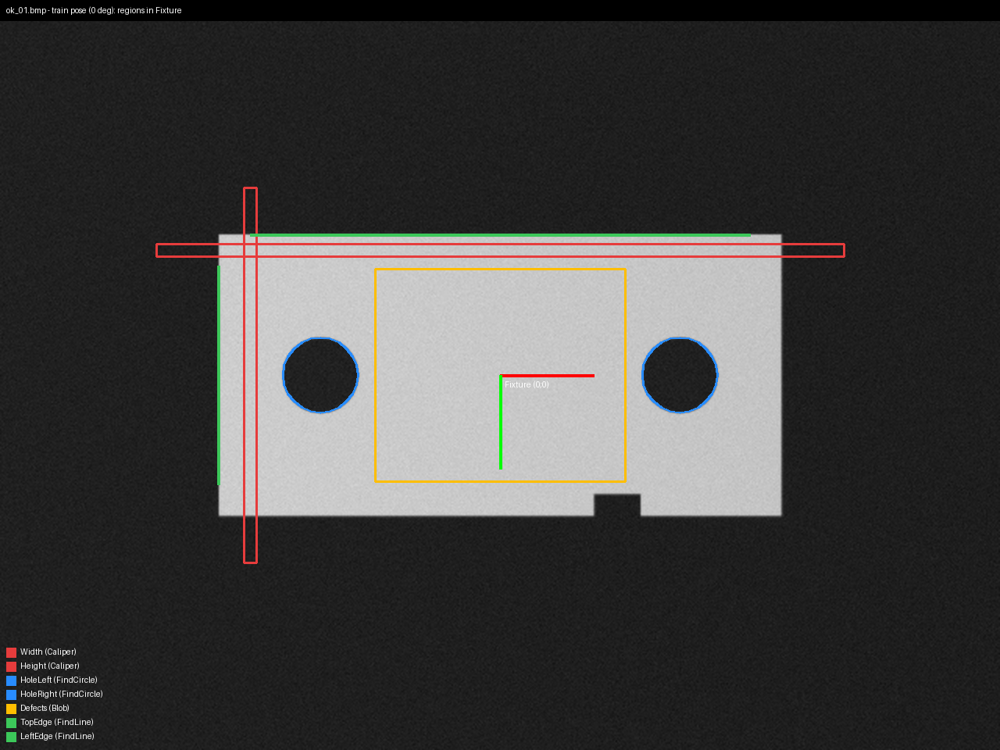

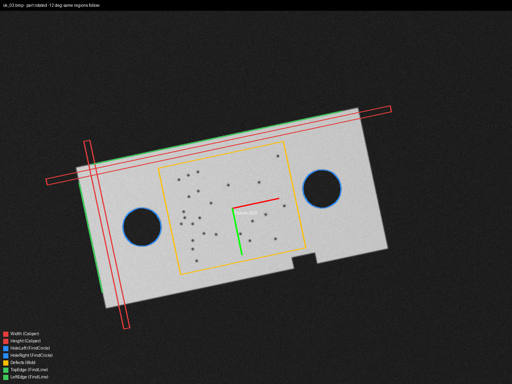

*Hình minh hoạ (Python, không phải ảnh chụp VisionPro): vùng của 7 tool trong job mẫu, khai một lần
trong hệ sản phẩm (gốc ở tâm tấm, trục đỏ = x, xanh = y). Tấm xoay −12° và dịch — vùng đi theo.*

## 4. Hai cách nối tool: kéo link hay viết script

**Cách 1 — kéo link trong editor ToolBlock** (không code). Kéo terminal ra của tool này thả vào
terminal vào của tool kia; ToolBlock chạy tool theo thứ tự và chép giá trị theo link. Ảnh chụp thật
từ spike giao diện (DESIGN_LOG [16]) cho thấy đúng chuỗi PMAlign → Fixture:

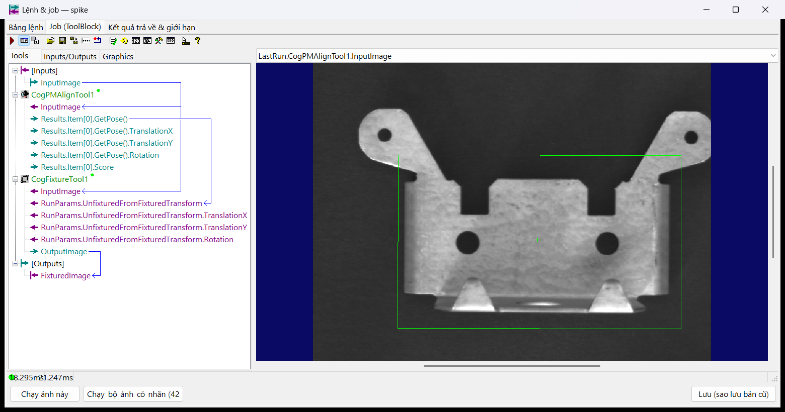

*Ảnh chụp VisionPro 9.0 CR2 thật (`docs/ui/spike/shots/tbedit.png`): `[Inputs].InputImage` →
`CogPMAlignTool1.InputImage`; `Results.Item[0].GetPose()` → `CogFixtureTool1.RunParams.
UnfixturedFromFixturedTransform`; `CogFixtureTool1.OutputImage` → `[Outputs].FixturedImage`. Khung
xanh lá trên ảnh là vùng train của PMAlign.*

**Cách 2 — script Advanced** gán `InputImage`, `RunParams` rồi gọi `RunTool` theo thứ tự tự chọn.

| | Kéo link | Script Advanced |
|---|---|---|
| Không tìm thấy (PMAlign 0 kết quả, Caliper 0 cạnh) | Link `Results.Item[0]` **ném lỗi** → tool sau Error, job báo Error thay vì NG | Kiểm `Results.Count == 0` → `Reject` có lý do rõ ("Locate: part not found") |
| Rẽ nhánh (nhiều kết quả, bỏ qua bước) | Không làm được | Tự do |
| Tham số nhanh (terminal input → `RunParams`) | Link được với tham số đơn giản | Gán trực tiếp, đổi kiểu tuỳ ý |
| Review, so khác bằng git | Nằm trong `.vpp` nhị phân | Script là văn bản — job mẫu để ở `scripts/*.cs` |
| Người không biết code sửa | Dễ | Khó hơn |

Job mẫu dùng **script** vì quy tắc của MeoVision: NG phải là NG có lý do, Error chỉ khi phần mềm/thiết
bị hỏng (Ch20, `ResultJudge`). Có thể trộn: link cho phần cố định, script chỉ để gán output và kiểm
rỗng — miễn là không có tool nào nhận `Results.Item[0]` qua link khi tool trước có thể không tìm thấy.

## 5. Hợp đồng job của MeoVision

Job chạy được trong MeoVision khi (`CogVisionJob`, `ProductLoader`, Ch19–22):

1. Là một `CogToolBlock` lưu bằng `CogSerializer` (`.vpp`), nạp qua `ScriptDialogGuard`.
2. Có input `InputImage` (`CogImage8Grey`); lệnh nhiều camera có thêm terminal ảnh riêng
   (`extraCameras[].terminal`).
3. Mỗi `outputs[].terminal` trong `product.json` là output có thật, kiểu số (hoặc chuỗi/bool không có
   giới hạn). Job **xoá hết output trước mỗi lần chạy** — output còn `null` = job không gán = lỗi.
4. Mỗi `tunables[].terminal` là input kiểu số; giá trị từ `product.json` được đổi sang kiểu của
   terminal (`Convert.ChangeType`) trước khi chạy.
5. `RunStatus`: **Accept** = đo được (giới hạn do MeoVision so), **Reject** = sản phẩm không đạt mà
   job tự biết (không thấy vật, thiếu lỗ), **Error** = không đo được vì lý do kỹ thuật.
6. Không giữ ảnh giữa hai lần chạy; không hiện hộp thoại; không ghi file.

---

# Phần II — Từng tool

Mỗi tool: **dùng khi**, **tham số quan trọng** (đường dẫn property đúng như trong code/script),
**kết quả**, **bẫy thường gặp**, **code**. Code của PMAlign, Fixture, Caliper, FindLine, FindCircle,
Blob, DistancePointPoint, IntersectLineLine, AngleLineLine lấy từ `samples/toolchains` (sẽ được
builder kiểm khi chạy `build.cmd`); phần còn lại ghi *(chưa chạy)*.

## 6. Định vị: PMAlign, Fixture

### 6.1 `CogPMAlignTool` — tìm mẫu


*Ảnh chụp VisionPro 9.0 CR2 thật (`build.cmd shots`, ảnh `ok_03.bmp` — tấm xoay −12°): `CogPMAlignEditV2` của tool Locate — tab Train Params, mẫu đã train (khung xanh), thuật toán PatMax & PatQuick.*

**Dùng khi:** cần biết sản phẩm nằm ở đâu, xoay bao nhiêu, để mọi phép đo sau bám theo; hoặc đếm/định
vị nhiều chi tiết giống nhau.

**Train** (`Pattern`, kiểu `CogPMAlignPattern`):

| Property | Ý nghĩa | Gợi ý |
|---|---|---|
| `Pattern.TrainImage` | Ảnh dùng để train (lưu luôn trong `.vpp` → file to thêm cỡ một ảnh) | Ảnh sản phẩm tốt, đúng đèn sản xuất |
| `Pattern.TrainRegion` | Vùng mẫu (`CogRectangle`, `CogRectangleAffine`, `CogCircle`…) | Ôm cả chi tiết + một dải nền để có cạnh ngoài; tránh vùng hay thay đổi (nhãn, bụi) |
| `Pattern.Origin` | Gốc mẫu (`CogTransform2DLinear`) — **gốc của hệ sản phẩm sau Fixture** | Đặt ở điểm có nghĩa: tâm tấm, tâm lỗ chuẩn, góc chuẩn |
| `Pattern.TrainAlgorithm` | PatQuick (nhanh, kém chính xác hơn), PatMax (subpixel), PatMax & PatQuick, PatFlex (vật biến dạng, license riêng), PatMax High Sensitivity (ảnh nhiễu/tương phản thấp) | Định vị cho đo: PatMax |
| `Pattern.Train()` / `Pattern.Trained` | Train / đã train chưa | Kiểm `Trained` trước khi lưu |

**Chạy** (`RunParams`, kiểu `CogPMAlignRunParams`):

| Property | Ý nghĩa | Gợi ý |
|---|---|---|
| `AcceptThreshold` | Điểm tối thiểu (0–1) để nhận một kết quả | 0,5–0,7; nên là tham số nhanh |
| `ApproximateNumberToFind` | Số kết quả cần tìm | 1 cho định vị; N cho đếm |
| `ZoneAngle.Configuration` + `Low`/`High` | Khoảng góc tìm (radian). **Mặc định là `Nominal` = chỉ đúng 0°** | `CogPMAlignZoneConstants.LowHigh`, ±(góc lệch tối đa + biên) |
| `ZoneScale` | Khoảng tỉ lệ | Để Nominal 1 nếu khoảng cách camera cố định |
| `SearchRegion` (của tool) | Vùng tìm; `null` = cả ảnh | Thu nhỏ để nhanh hơn và không bắt nhầm |
| `TimeoutEnabled`, `Timeout` | Giới hạn thời gian tìm (ms) | Bật, nhỏ hơn `timeoutMs` của lệnh |

**Kết quả:** `Results.Count`; `Results[i].Score`; `Results[i].GetPose()` → `CogTransform2DLinear`
(`TranslationX/Y`, `Rotation` radian, `Scaling`) — phép biến đổi **hệ mẫu → hệ đang chọn của ảnh**,
đúng thứ Fixture cần. Kết quả xếp theo điểm giảm dần.

**Bẫy:**
- Để `ZoneAngle` mặc định → chỉ tìm được sản phẩm thẳng góc, lệch 5° là rớt điểm/không thấy.
- Sản phẩm đối xứng 180° (tấm chữ nhật + 2 lỗ đối xứng) → PMAlign có thể khớp ngược chiều; cần chi tiết
  phá đối xứng (tấm mẫu có **rãnh khuyết**) và/hoặc thu hẹp `ZoneAngle`. **Đo thật (2026-11-04):** ngay
  cả với rãnh khuyết, vùng ±180° nhận `ok_04` (xoay 14°) ở **−166°, score 0,923** dù có ứng viên 1,000;
  ±45° nhận đúng. `ApproximateNumberToFind = 2` + `XYOverlap = 1` thì kết quả #0 đúng; PMAlign thứ hai
  chỉ quanh rãnh tìm đúng 13,99°. Chi tiết + 4 bài học PMAlign đo thật khác: sách Ch25 §25.3; tham số
  PMAlign trong 133 tool của job công khai (timeout tắt 133/133, ±180° ở 81): sách Ch26 §26.3.3.
- **Train lại = đổi gốc hệ sản phẩm** nếu đặt gốc khác → mọi vùng phía sau lệch theo. Luôn đặt
  `Origin` bằng số, không kéo tay.
- Đổi đèn/độ phơi sáng làm điểm tụt nhưng vị trí vẫn đúng — xem điểm theo thời gian trước khi hạ
  `AcceptThreshold`.

**Code** (`MakeToolChainJobs.NewBlock`):

```csharp
CogPMAlignTool locate = new CogPMAlignTool { Name = "Locate" };
CogRectangle region = new CogRectangle();
region.SetCenterWidthHeight(TrainCenterX, TrainCenterY, PlateW + 40, PlateH + 40);
locate.Pattern.TrainImage = train;
locate.Pattern.TrainRegion = region;
locate.Pattern.Origin.TranslationX = TrainCenterX;   // gốc hệ sản phẩm = tâm tấm
locate.Pattern.Origin.TranslationY = TrainCenterY;
locate.Pattern.Train();
locate.RunParams.ZoneAngle.Configuration = CogPMAlignZoneConstants.LowHigh;
locate.RunParams.ZoneAngle.Low = -Math.PI / 6;
locate.RunParams.ZoneAngle.High = Math.PI / 6;
locate.RunParams.ApproximateNumberToFind = 1;
```

### 6.2 `CogFixtureTool` — gắn hệ sản phẩm vào ảnh


*Ảnh chụp VisionPro 9.0 CR2 thật (`build.cmd shots`, ảnh `ok_03.bmp` — tấm xoay −12°): `CogFixtureEditV2` — phép biến đổi lấy từ `GetPose()` của Locate.*

**Dùng khi:** luôn đi ngay sau PMAlign (hoặc sau bất kỳ tool nào cho ra một phép biến đổi) để các tool
sau khai vùng trong hệ sản phẩm.

| Property | Ý nghĩa |
|---|---|
| `InputImage` | Ảnh gốc (hoặc ảnh đã hiệu chuẩn) |
| `RunParams.UnfixturedFromFixturedTransform` | Phép biến đổi hệ sản phẩm → hệ ảnh vào: chính `GetPose()` của PMAlign |
| `RunParams.FixturedSpaceName` | Tên hệ thêm vào (mặc định `Fixture`) |
| `OutputImage` | **Cùng pixel** với ảnh vào (không chép ảnh, gần như không tốn thời gian), thêm hệ mới và chọn nó |

**Bẫy:** cho tool sau ảnh *vào* của Fixture mà vùng để hệ `.` → tool Accept nhưng không có kết quả, không báo
lỗi. Hai cách đúng (đo thật 2026-11-04, sách Ch27 Bảng 27.5): ảnh *ra* + hệ `.` → kết quả theo hệ chi tiết; ảnh
*vào* + vùng khai tên hệ `Fixture` → kết quả theo hệ của ảnh vào (job dẫn hướng thật hay dùng cách này). **Bẫy thứ hai (đo thật 2026-11-03):** `OutputImage` dùng chung pixel *và cây hệ toạ độ* với ảnh vào —
hệ `Fixture` được ghi vào chính ảnh vào. Một job KHÁC (đối tượng nạp riêng, dù cùng file `.vpp`) chạy sau
trên cùng ảnh thì Fixture của nó lỗi *"This fixture tool has just modified a coordinate space that it did
not create"*. `image.Copy(...)` và `CopyBase(...)` **vẫn dùng chung cây đó** (bản sao lấy trước khi job
đầu chạy vẫn thấy hệ `Fixture` thêm sau); chỉ constructor sao chép `new CogImage8Grey(img)` tách cây
(giữ các hệ đã có, như hiệu chuẩn). MeoVision gặp đúng lỗi này ở chạy kèm bản nháp — DESIGN_LOG [31]. Khi chỉ có điểm (tâm hai lỗ, hai dấu) thay vì một mẫu: `CogFixtureNPointToNPointTool`.

```csharp
// trong script (scripts/C1_measure.cs, hàm Locate)
mPose = locate.Results[0].GetPose();
fixture.InputImage = image;
fixture.RunParams.UnfixturedFromFixturedTransform = mPose;
if (!Step(fixture, ref message, ref result)) { return null; }
return (CogImage8Grey)fixture.OutputImage;
```

## 7. Đo cạnh: Caliper, FindLine, FindCircle

### 7.1 `CogCaliperTool` — một cạnh / một cặp cạnh

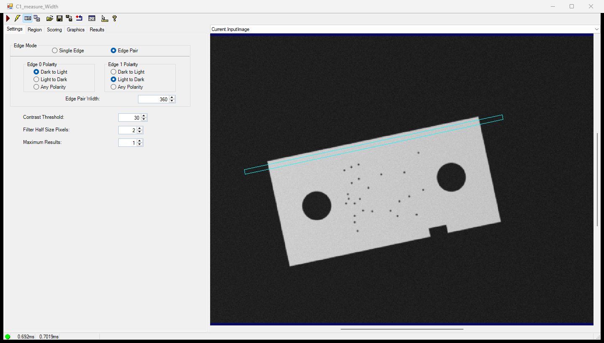
*Ảnh chụp VisionPro 9.0 CR2 thật (`build.cmd shots`, ảnh `ok_03.bmp` — tấm xoay −12°): Caliper Width chế độ cặp cạnh, vùng khai trong hệ Fixture nên xoay theo tấm.*

**Dùng khi:** đo bề rộng, khe hở, vị trí một cạnh dọc một hướng đã biết.

Vùng là `CogRectangleAffine`: **trục x của hình chữ nhật = hướng tìm** (độ dài `SideXLength` = độ dài
tìm), **trục y = hướng chiếu** (`SideYLength`: các hàng pixel dọc trục y được cộng trung bình để giảm
nhiễu). Xoay hình chữ nhật 90° là tìm theo hướng khác.

| Property (`RunParams`, kiểu `CogCaliper`) | Ý nghĩa | Gợi ý |
|---|---|---|
| `EdgeMode` | `SingleEdge` / `Pair` | Đo bề rộng: `Pair` |
| `Edge0Polarity`, `Edge1Polarity` | `DarkToLight`, `LightToDark`, `DontCare` — **theo hướng tìm** | Đặt đúng, đừng để `DontCare` khi biết trước |
| `Edge0Position`, `Edge1Position` | Vị trí dự kiến của hai cạnh, tính từ tâm vùng theo hướng tìm — bề rộng cặp dự kiến = hiệu hai số (dùng khi có hàm chấm điểm theo kích thước). Không có property "EdgePairWidth" | `-w/2` và `+w/2` |
| `ContrastThreshold` | Độ chênh xám tối thiểu của một cạnh | 20–40 với ảnh 8 bit |
| `FilterHalfSizeInPixels` | Nửa bề rộng bộ lọc cạnh | ≈ nửa độ "nhoè" của cạnh; lớn quá nhập hai cạnh gần nhau |
| `MaxResults` | Số kết quả giữ | 1 |

**Kết quả:** `Results.Count`; `Results[0].Width` (cặp), `Results[0].Edge0.PositionX/Y`,
`Results[0].PositionX/Y` (giữa cặp), `Results[0].Score`.

**Bẫy:** cạnh khác (lỗ, vết bẩn) nằm trong dải chiếu → chọn nhầm cặp (job mẫu đặt caliper bề rộng ở
`y = −80`, tránh vùng lỗi, và caliper chiều cao ở `x = −160`, tránh hai lỗ — xem hình ở mục 3);
`SideYLength` dài trên cạnh cong làm nhoè cạnh.

```csharp
// MakeToolChainJobs.NewCaliper — vùng khai trong hệ sản phẩm (sau Fixture)
CogCaliperTool tool = new CogCaliperTool { Name = name };
CogRectangleAffine region = new CogRectangleAffine();
region.SetCenterLengthsRotationSkew(cx, cy, searchLength, projectionLength, rotation, 0);
tool.Region = region;
tool.RunParams.EdgeMode = CogCaliperEdgeModeConstants.Pair;
tool.RunParams.Edge0Polarity = CogCaliperPolarityConstants.DarkToLight;
tool.RunParams.Edge1Polarity = CogCaliperPolarityConstants.LightToDark;
tool.RunParams.Edge0Position = -expectedWidth / 2;   // bề rộng cặp dự kiến
tool.RunParams.Edge1Position = expectedWidth / 2;
tool.RunParams.ContrastThreshold = 30;
tool.RunParams.FilterHalfSizeInPixels = 2;
tool.RunParams.MaxResults = 1;
```

### 7.2 `CogFindLineTool` — đường thẳng từ nhiều caliper

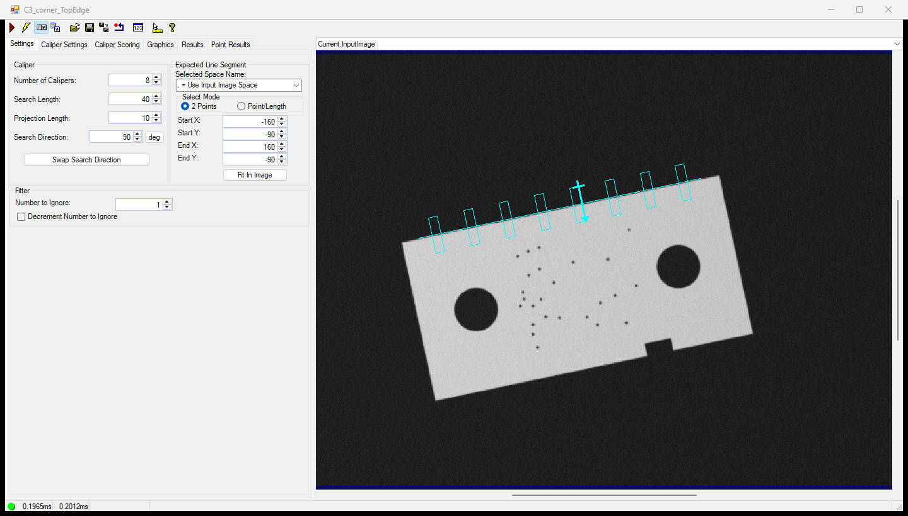
*Ảnh chụp VisionPro 9.0 CR2 thật (`build.cmd shots`, ảnh `ok_03.bmp` — tấm xoay −12°): FindLine TopEdge — các caliper nhỏ dọc cạnh trên.*

**Dùng khi:** cần một cạnh thẳng chính xác (góc xoay tinh, khoảng cách điểm–cạnh, giao hai cạnh).

| Property (`RunParams`, kiểu `CogFindLine`) | Ý nghĩa | Gợi ý |
|---|---|---|
| `ExpectedLineSegment` (`StartX/Y`, `EndX/Y`) | Đoạn dự kiến — **chiều Start → End quyết định hướng tìm** | Khai trong hệ sản phẩm |
| `NumCalipers` | Số caliper rải dọc đoạn | 6–12 |
| `CaliperSearchLength`, `CaliperProjectionLength` | Kích thước mỗi caliper | Search ≥ 2 × sai lệch vị trí tối đa |
| `CaliperSearchDirection` | Góc (radian) giữa hướng tìm và chiều đoạn; mặc định +90° | Giữ +90°, đổi chiều đoạn nếu cần tìm phía kia |
| `CaliperRunParams` | Một `CogCaliper` dùng chung cho mọi caliper (polarity, contrast…) | |
| `NumToIgnore` | Bỏ N điểm lệch xa nhất trước khi khớp | 1–2 (bụi, ba-via) |

**Kết quả:** `Results.GetLine()` (`CogLine`: `X`, `Y`, `Rotation`) hoặc `GetLineSegment()`;
`Results.RMSError`; `Results[i]` là từng caliper (tìm thấy/được dùng). `GetLine()` không có kết quả
khi không đủ điểm — script mẫu bọc `try/catch` và coi là Reject.

**Bẫy:** đảo chiều Start/End mà quên đổi polarity → không thấy cạnh; đoạn dự kiến chạm góc tấm →
caliper đầu/cuối rơi ra ngoài (job mẫu chừa 20 px mỗi đầu).

```csharp
// MakeToolChainJobs.NewEdge — cạnh trên: trái → phải, +90° = hướng +y = vào trong tấm
tool.RunParams.ExpectedLineSegment.StartX = -160;
tool.RunParams.ExpectedLineSegment.StartY = -90;
tool.RunParams.ExpectedLineSegment.EndX = 160;
tool.RunParams.ExpectedLineSegment.EndY = -90;
tool.RunParams.NumCalipers = 8;
tool.RunParams.CaliperSearchLength = 40;
tool.RunParams.CaliperProjectionLength = 10;
tool.RunParams.CaliperSearchDirection = Math.PI / 2;
CogCaliper caliper = tool.RunParams.CaliperRunParams;
caliper.Edge0Polarity = CogCaliperPolarityConstants.DarkToLight;   // nền tối → tấm sáng
caliper.ContrastThreshold = 30;
tool.RunParams.NumToIgnore = 1;
```

### 7.3 `CogFindCircleTool` — đường tròn từ nhiều caliper

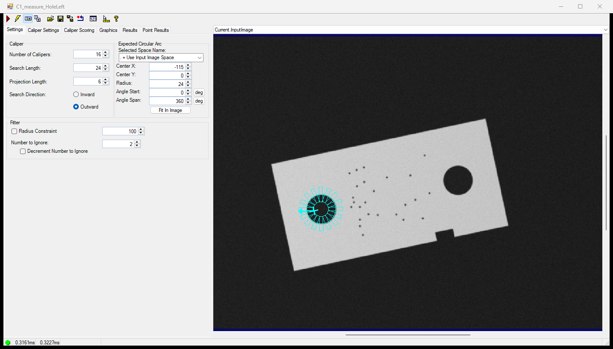
*Ảnh chụp VisionPro 9.0 CR2 thật (`build.cmd shots`, ảnh `ok_03.bmp` — tấm xoay −12°): FindCircle HoleLeft — caliper toả ra từ trong lỗ.*

| Property (`RunParams`, kiểu `CogFindCircle`) | Ý nghĩa |
|---|---|
| `ExpectedCircularArc.SetCenterRadiusAngleStartAngleSpan(cx, cy, r, start, span)` | Cung dự kiến; `span = 2π` là cả vòng |
| `NumCalipers`, `CaliperSearchLength`, `CaliperProjectionLength` | Như FindLine |
| `CaliperSearchDirection` | `CogFindCircleSearchDirectionConstants.Inward` / `Outward` |
| `CaliperRunParams.Edge0Polarity` | Theo hướng tìm: lỗ tối trên tấm sáng + `Outward` → `DarkToLight` |
| `NumToIgnore` | Bỏ điểm xa nhất |

**Kết quả:** `Results.GetCircle()` (`CogCircle`: `CenterX`, `CenterY`, `Radius`), `RMSError`.
**Bẫy:** search length lớn hơn bán kính khi tìm `Inward` → caliper vượt qua tâm, bắt cạnh đối diện.

```csharp
CogFindCircleTool tool = new CogFindCircleTool { Name = "HoleLeft" };
tool.RunParams.ExpectedCircularArc.SetCenterRadiusAngleStartAngleSpan(
    -115, 0, 24, 0, 2 * Math.PI);
tool.RunParams.NumCalipers = 16;
tool.RunParams.CaliperSearchLength = 24;
tool.RunParams.CaliperProjectionLength = 6;
tool.RunParams.CaliperSearchDirection = CogFindCircleSearchDirectionConstants.Outward;
tool.RunParams.CaliperRunParams.Edge0Polarity = CogCaliperPolarityConstants.DarkToLight;
tool.RunParams.NumToIgnore = 2;
```

## 8. Vùng và đếm: Blob, Histogram

### 8.1 `CogBlobTool`

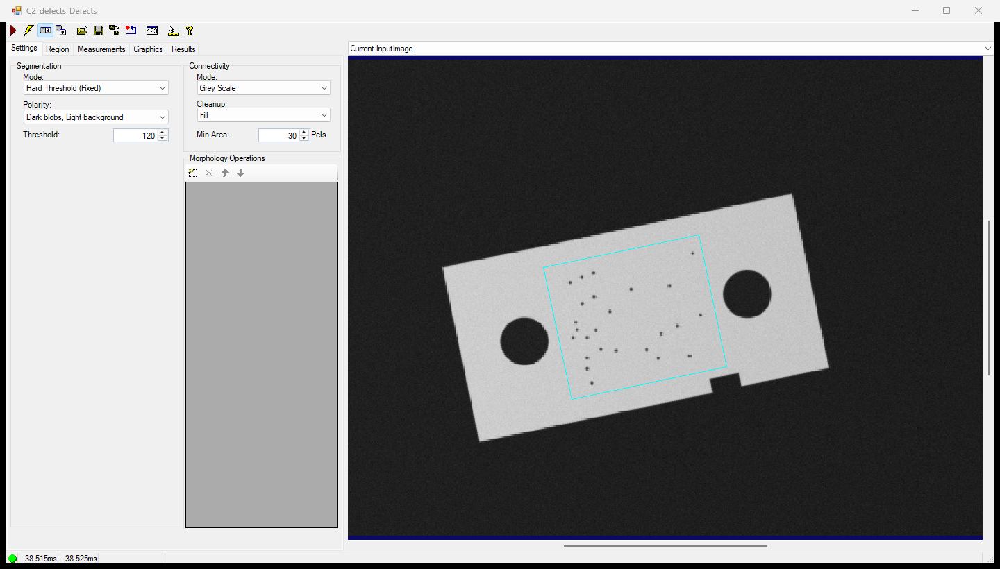
*Ảnh chụp VisionPro 9.0 CR2 thật (`build.cmd shots`, ảnh `ok_03.bmp` — tấm xoay −12°): Blob Defects — vùng tìm (khung xanh) đi theo tấm; đốm bụi nhỏ hơn Min Area 30 bị lọc.*

**Dùng khi:** đếm đốm/lỗi/chi tiết, đo diện tích, tìm vật không có hình dạng cố định.

| Property (`RunParams`, kiểu `CogBlob`) | Ý nghĩa | Gợi ý |
|---|---|---|
| `SegmentationParams.Mode` | `HardFixedThreshold` (ngưỡng cố định), `HardRelativeThreshold` (theo % histogram — chịu được đèn trôi), `HardDynamicThreshold`, `SoftFixedThreshold`, ảnh trừ nền… | Bắt đầu với Fixed; đèn hay đổi → Relative |
| `SegmentationParams.Polarity` | `DarkBlobs` / `LightBlobs` | |
| `SegmentationParams.HardFixedThreshold` | Ngưỡng xám (0–255) | Tham số nhanh |
| `ConnectivityMode` | Greyscale (đốm theo liên thông) / WholeImage (cả vùng là một blob) | |
| `ConnectivityMinPixels` | Đốm nhỏ hơn N **pixel** bị bỏ (lọc bụi) | Tham số nhanh |
| `ConnectivityCleanup` | Fill / Prune / None — xử lý đốm nhỏ hơn MinPixels | |
| `RunTimeMeasures` | Danh sách phép đo; mỗi phép có thể là bộ lọc (Area trong khoảng…) hoặc khoá sắp xếp | Lọc theo Area/Elongation thay vì lọc trong script |
| `Region` (của tool) | Vùng xét; `null` = cả ảnh | **Chỉ ôm vùng cần xét** |

**Kết quả:** `Results.GetBlobs()` → `CogBlobResultCollection`; mỗi `CogBlobResult`: `Area`,
`CenterOfMassX/Y`, `GetBoundingBox(...)`, `Perimeter`, `Elongation`…; `Area` báo trong hệ đang chọn
(ảnh có hiệu chuẩn → mm²), còn `ConnectivityMinPixels` luôn là pixel.

**Bẫy:**
- Vùng ôm cả lỗ/rãnh/cạnh tấm → lỗ cũng là "đốm tối" (gặp thật khi dựng bộ ảnh mẫu, mô phỏng ngưỡng
  bằng Python: rãnh khuyết lấn vào vùng ra thêm một đốm ~72 px trên ảnh OK — sửa bằng cách thu vùng về
  ±68 và rãnh còn sâu 14 px).
- Ngưỡng cố định + đèn trôi theo ca → số đốm nhảy; theo dõi `Brightness` (job T1) cùng lúc.
- Vùng xoay theo Fixture: Blob xét theo mặt nạ của vùng trên lưới pixel — không nội suy lại ảnh.

```csharp
// MakeToolChainJobs.NewDefectBlob — vùng giữa hai lỗ, trong hệ sản phẩm
CogBlobTool tool = new CogBlobTool { Name = "Defects" };
CogRectangleAffine region = new CogRectangleAffine();
region.SetCenterLengthsRotationSkew(0, 0, 160, 136, 0, 0);
tool.Region = region;
CogBlobSegmentationParams segmentation = tool.RunParams.SegmentationParams;
segmentation.Mode = CogBlobSegmentationModeConstants.HardFixedThreshold;
segmentation.Polarity = CogBlobSegmentationPolarityConstants.DarkBlobs;
segmentation.HardFixedThreshold = 120;
tool.RunParams.ConnectivityMinPixels = 30;
```

### 8.2 `CogHistogramTool`

**Dùng khi:** độ sáng trung bình (kiểm đèn hỏng/độ phơi sáng — job `T1_mean.vpp`), có/không có vật
trong một vùng, tương phản.
**Kết quả:** `Result.Mean`, `Result.StandardDeviation`, `Result.Minimum`, `Result.Maximum`,
`Result.Mode`, `Result.Median`. **Bẫy:** `Result` là `null` khi chưa chạy hoặc lỗi — `T1_mean.vpp`
trả `NaN` thay vì văng.

```csharp
// samples/products/MakeSampleJobs.cs — job T1 (đã chạy thật, Ch19–20)
CogHistogramTool h = (CogHistogramTool)mToolBlock.Tools["Histogram"];
h.InputImage = (CogImage8Grey)image;
mToolBlock.RunTool(h, ref message, ref result);
mToolBlock.Outputs["Mean"].Value = h.Result == null ? double.NaN : h.Result.Mean;
```

## 9. Hình học (Dimensioning)

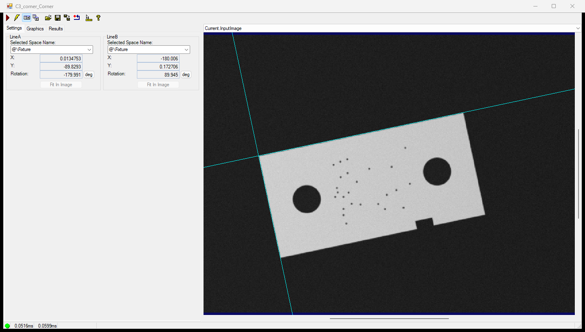
*Ảnh chụp VisionPro 9.0 CR2 thật (`build.cmd shots`, ảnh `ok_03.bmp` — tấm xoay −12°): IntersectLineLine Corner — hai đường từ FindLine, giao điểm là góc tấm.*

Tool hình học **không xử lý ảnh**: nhận điểm/đường/đường tròn từ tool trước, tính số. `InputImage` chỉ
để biết hệ toạ độ và vẽ đồ hoạ vào record. Đây là "keo" nối các tool đo cạnh với nhau.

| Việc | Tool | Vào | Ra |
|---|---|---|---|
| Khoảng cách hai điểm (bước lỗ) | `CogDistancePointPointTool` | `StartX/Y`, `EndX/Y` | `Distance`, `Angle` |
| Điểm – đường (độ lệch tâm so với cạnh) | `CogDistancePointLineTool` | điểm + `CogLine` | khoảng cách có dấu |
| Điểm – đường tròn, đường – đường tròn, tròn – tròn | `CogDistancePointCircleTool`, `CogDistanceLineCircleTool`, `CogDistanceCircleCircleTool` | | |
| Góc giữa hai đường (độ vuông góc, song song) | `CogAngleLineLineTool` | `LineA`, `LineB` | `Angle` (radian) |
| Giao hai đường (góc ảo, điểm dẫn robot) | `CogIntersectLineLineTool` | `LineA`, `LineB` | `X`, `Y`, `Angle`, `Intersects` |
| Giao đường – tròn, tròn – tròn | `CogIntersectLineCircleTool`, `CogIntersectCircleCircleTool` | | |
| Dựng đường qua 2 điểm, song song, vuông góc, phân giác | `CogCreateLine*Tool` | | `CogLine` |
| Khớp đường/tròn/elip từ tập điểm tự có | `CogFitLineTool`, `CogFitCircleTool`, `CogFitEllipseTool` | điểm | hình |

Tên đầy đủ của cả nhóm xem trong Toolbox của QuickBuild, mục *Geometry*. Ba tool đầu bảng dùng trong job
mẫu:

```csharp
// scripts/C1_measure.cs — bước lỗ từ kết quả hai FindCircle
pitch.InputImage = part;
pitch.StartX = left.CenterX;
pitch.StartY = left.CenterY;
pitch.EndX = right.CenterX;
pitch.EndY = right.CenterY;
if (!Step(pitch, ref message, ref result)) { return false; }
mToolBlock.Outputs["Pitch"].Value = pitch.Distance;
```

**Bẫy:** `AngleLineLine.Angle` có dấu và phụ thuộc chiều của hai đường (−90° hay +90°, 0° hay 180°)
— quy về khoảng cần dùng trong script (job C3 lấy góc nhọn ≤ 90°).

## 10. Tiền xử lý, màu, mã, chữ, hiệu chuẩn, phán định

Các tool này không có trong ba job mẫu (ảnh mẫu là xám, không có mã/chữ); mô tả đủ để chọn đúng tool và
biết nối nó vào đâu.

### 10.1 `CogImageConvertTool` — màu → xám

Đặt **đầu chuỗi** khi camera màu nhưng tool sau cần `CogImage8Grey` (PMAlign, Caliper, Blob đều chỉ nhận
ảnh xám). Chế độ: cường độ (trung bình kênh), một kênh R/G/B, một kênh H/S/I. Chọn kênh có tương phản
cao nhất giữa vật và nền — nhiều khi tốt hơn hẳn "Intensity". Trong MeoVision, camera thư mục đã tự đổi
ảnh màu sang xám cường độ (`FolderCamera`, `CogImageConvert.GetIntensityImage`) vì job nhận
`InputImage` kiểu `CogImage8Grey`; job cần một kênh màu riêng thì phải nhận ảnh màu qua một terminal
riêng và đặt `CogImageConvertTool` đầu chuỗi.

### 10.2 `CogIPOneImageTool` — chuỗi phép lọc

Một tool chứa danh sách phép (thêm trong editor, tab *Operators*): hình thái học xám (giãn/co/mở/đóng —
xoá bụi nhỏ trước Blob, lấp vết xước mảnh), lượng tử hoá, lật/xoay, chuẩn hoá… Đặt giữa ảnh và tool
cần ảnh sạch hơn; **sau Fixture** vẫn giữ hệ toạ độ. Lọc mạnh làm dịch cạnh — không đặt trước Caliper đo
kích thước chính xác.

### 10.3 `CogIDTool` — mã vạch, DataMatrix, QR

Bật **chỉ** loại mã có thật (bật tất cả làm chậm và tăng đọc nhầm); vùng tìm sau Fixture để đi theo nhãn.
Kết quả: `Results.Count`, `Results[0].DecodedData.DecodedString`. Có tuỳ chọn chấm điểm chất lượng mã
(ISO 15415/15416) cho trạm kiểm in. *(chưa chạy)*:

```csharp
CogIDTool id = (CogIDTool)mToolBlock.Tools["Code"];
id.InputImage = part;                       // ảnh ra của Fixture
if (!Step(id, ref message, ref result)) { return false; }
if (id.Results == null || id.Results.Count == 0)
{ return Reject("Code: no symbol", ref message, ref result); }
mToolBlock.Outputs["Serial"].Value = id.Results[0].DecodedData.DecodedString;
```

Output chuỗi trong MeoVision: khai trong `outputs` **không** có `lower/upper` (ProductLoader chỉ cho
giới hạn với output số).

### 10.4 `CogOCRMaxTool` — đọc chữ

Train font từ ảnh chữ thật (tab *Font*), đặt vùng một dòng chữ sau Fixture, đặt *fielding* (mẫu ký tự
từng vị trí: số/chữ) để loại đọc nhầm `0`/`O`, `1`/`I`. Dòng chữ nghiêng/cong: trải phẳng trước
(`CogPolarUnwrapTool` cho chữ quanh vòng tròn).

### 10.5 Màu: `CogColorMatchTool`, `CogColorSegmenterTool`, `CogColorExtractorTool`

ColorMatch: train bảng màu (vd. 4 màu dây), cho biết vùng giống màu nào nhất — kiểm lắp đúng màu.
ColorSegmenter/Extractor: tách vùng theo màu thành ảnh xám/nhị phân → đưa vào Blob để đếm/đo.

### 10.6 Hiệu chuẩn: `CogCalibCheckerboardTool`, `CogCalibNPointToNPointTool`

Trong MeoVision hiệu chuẩn **không nằm trong job**: là file `machine\calibration\<tên>\calibration.vpp`
của máy, gắn vào ảnh trước khi chạy job (`CogCalibrationLoader`, hệ `@\Calibrated`); máy dẫn
CS/CP/CE dựng lại bằng `CogNPointCalibrationBuilder` (Ch21). Editor N điểm (ảnh chụp thật, spike):

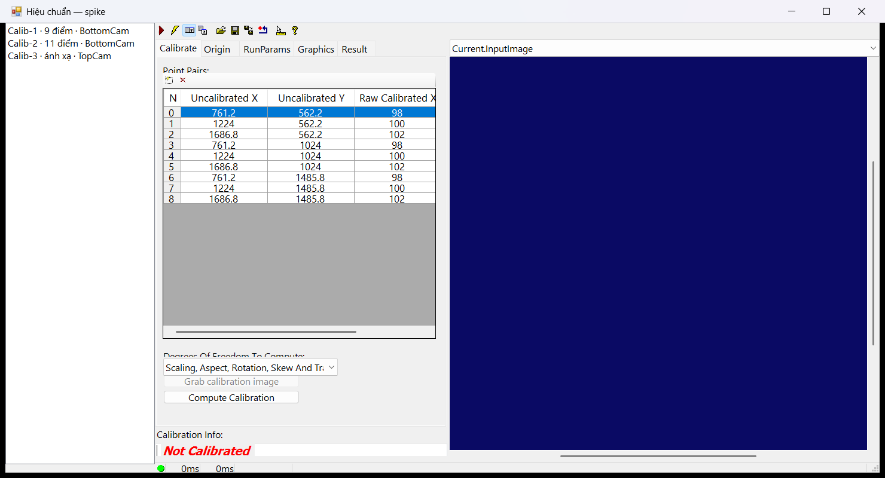

Hệ quả cho job: viết job ở pixel, bật `calibration` trên lệnh → cùng job ra mm (mục 3).

### 10.7 `CogResultsAnalysisTool` — phán định không cần script

Nhận các số (link từ tool khác), so giới hạn/biểu thức, đặt `RunStatus` Accept/Reject. Hữu ích trong
QuickBuild; trong MeoVision giới hạn đã nằm ở `product.json` (sửa không cần mở job, có nhật ký thay
đổi — Ch22/23) nên **không** dùng tool này cho giới hạn sản xuất.

### 10.8 Thu ảnh trong QuickBuild: `CogAcqFifoTool`

Ảnh chụp thật editor thu ảnh (spike, không có camera):

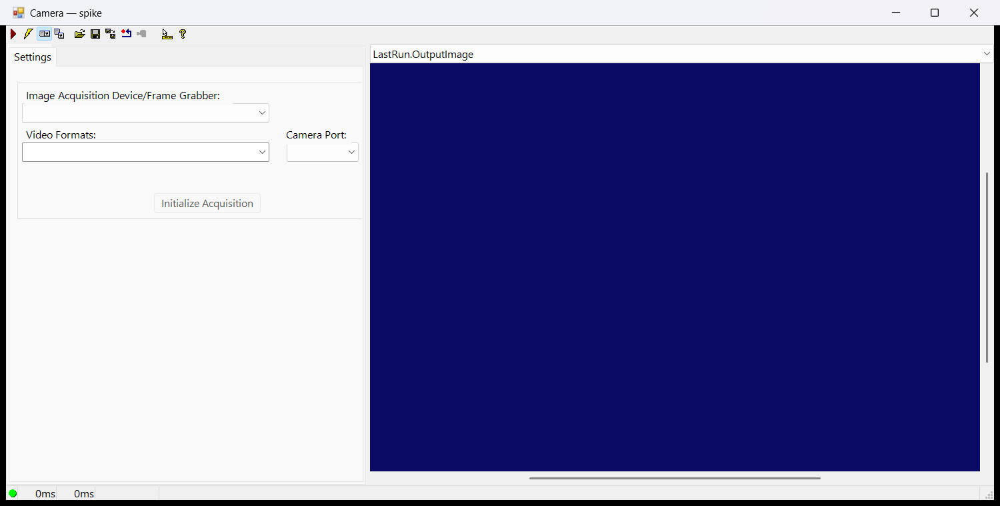

MeoVision không dùng tool này trong job: camera là thiết bị cấp máy (`CognexGigECamera`, Ch18), job chỉ
nhận ảnh qua `InputImage` — cùng job chạy được với camera thật, thư mục ảnh, ảnh đã lưu và bộ ảnh có
nhãn (Ch24).

---

# Phần III — Nối nhiều tool

## 11. Ba job mẫu hoàn chỉnh

Thư mục `samples/toolchains/`:

| File | Vai trò |
|---|---|
| `make_bracket_images.py` | Sinh 8 ảnh 640×480 + `truth.csv` (đáp án) + hình vùng tool `docs/vision-tools/img` |
| `images/*.bmp`, `images/truth.csv` | Bộ ảnh mẫu (đã sinh sẵn, commit kèm) |
| `scripts/C1_measure.cs`, `C2_defects.cs`, `C3_corner.cs` | **Script ToolBlock đầy đủ** — nguồn duy nhất; dán được vào editor script của VisionPro |
| `MakeToolChainJobs.cs` | Dựng tool + tham số + train PMAlign, nạp script, lưu `jobs/*.vpp`, **nạp lại và chạy cả bộ ảnh, so đáp án** |
| `ToolShots.cs` | Chụp editor VisionPro của từng tool sau khi chạy → `docs/vision-tools/shots` |
| `build.cmd` | Biên dịch + chạy hai chương trình trên (Windows, VS2022, VisionPro 9.x x64) |
| `product.json` | Sản phẩm mẫu `P-2048` nối ba job thành ba lệnh M1/M2/M3 |

### 11.1 Sản phẩm và bộ ảnh

Tấm kim loại sáng 360 × 180 px trên nền tối; hai lỗ Ø48 tại (±115; 0) — bước lỗ 230; rãnh khuyết 30 ×
14 ở cạnh dưới (phá đối xứng cho PMAlign). Mỗi ảnh xoay/dịch khác nhau, ánh sáng không đều, nhiễu
σ = 3, cạnh có subpixel (vẽ ×4 rồi thu nhỏ).

| Ảnh | Góc | Đặc điểm | C1 đo | C2 lỗi | C3 góc tấm (x; y) |
|---|---|---|---|---|---|
| `ok_01` | 0° | ảnh train, tư thế gốc | 360 × 180, bước 230, Ø48 | 0 | (140,00; 150,00) |
| `ok_02` | +8,5° | 15 hạt bụi | như trên | 0 | (185,28; 109,38) |
| `ok_03` | −12° | 25 hạt bụi | như trên | 0 | (95,22; 209,39) |
| `ok_04` | +14° | | như trên | 0 | (182,12; 124,13) |
| `ng_defect_05` | −5° | 3 lỗi | như trên | **3** | (117,84; 161,03) |
| `ng_defect_06` | +11° | 1 lỗi + 20 bụi | như trên | **1** | (170,48; 122,31) |
| `ng_hole_07` | +3° | **thiếu lỗ phải** | **Reject** "HoleRight: hole not found" | 0 | (139,96; 130,70) |
| `ng_long_08` | −7° | **tấm dài 380** | Width **380** → NG theo giới hạn | 0 | (120,45; 173,83) |

Lỗi = đốm tối Ø10–14 (~110 px sau ngưỡng); bụi = Ø3 (≤ 7 px) — `MinArea = 30` tách hai loại.

### 11.2 C1 — đo kích thước (`C1_measure.vpp`)

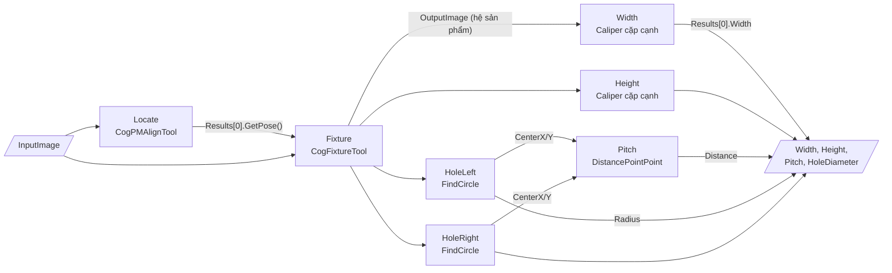

| Tool | Vùng / tham số (hệ sản phẩm, pixel) | Vì sao |
|---|---|---|
| `Locate` | train 400 × 220 quanh tâm (320; 240) của `ok_01`, gốc = tâm tấm, góc ±30° | gốc hệ sản phẩm có nghĩa; ±30° bao ±15° thực tế |
| `Fixture` | `UnfixturedFromFixturedTransform` = pose | mọi vùng sau đi theo tấm |
| `Width` | tâm (0; −80), search 440 dọc x, chiếu 8, cặp Dark→Light / Light→Dark | dải sát cạnh trên, không cắt lỗ, không cắt vùng lỗi |
| `Height` | tâm (−160; 0), search 240, xoay 90° (tìm dọc y) | giữa cạnh trái và lỗ trái |
| `HoleLeft/Right` | tâm (∓115; 0), r = 24, 16 caliper, search 24, `Outward`, Dark→Light | từ trong lỗ (tối) ra tấm (sáng) |
| `Pitch` | Start = tâm lỗ trái, End = tâm lỗ phải | tool hình học nối hai FindCircle |

Tham số nhanh: `AcceptThreshold` (double, 0,6). Script đầy đủ — `samples/toolchains/scripts/C1_measure.cs`:

```csharp
// Script ToolBlock — Advanced, C# 5 (script compiler của VisionPro 9.0 CR2).
// C1 — đo kích thước: PMAlign → Fixture → Caliper ×2 + FindCircle ×2 → DistancePointPoint
using System;
using Cognex.VisionPro;
using Cognex.VisionPro.ToolBlock;
using Cognex.VisionPro.PMAlign;
using Cognex.VisionPro.CalibFix;
using Cognex.VisionPro.Caliper;
using Cognex.VisionPro.Dimensioning;
public class CogToolBlockAdvancedScript : CogToolBlockAdvancedScriptBase
{
  private CogToolBlock mToolBlock;
  // Tư thế tấm của LẦN CHẠY NÀY: hệ tấm → hệ đang chọn của ảnh vào (pixel, hoặc mm nếu ảnh
  // tới đã có hiệu chuẩn). Dùng để đổi kết quả đo trong hệ tấm ngược ra toạ độ ảnh/máy.
  private CogTransform2DLinear mPose;

  public override void Initialize(Cognex.VisionPro.ToolGroup.CogToolGroup host)
  { base.Initialize(host); mToolBlock = (CogToolBlock)host; }
  public override void ModifyCurrentRunRecord(ICogRecord currentRecord) { }
  public override void ModifyLastRunRecord(ICogRecord lastRecord) { }

  // Chạy một tool; tool báo Error thì dừng cả job với tên tool trong thông báo.
  private bool Step(ICogTool tool, ref string message, ref CogToolResultConstants result)
  {
    mToolBlock.RunTool(tool, ref message, ref result);
    if (tool.RunStatus.Result == CogToolResultConstants.Error)
    {
      message = tool.Name + ": " + tool.RunStatus.Message;
      result = CogToolResultConstants.Error;
      return false;
    }
    return true;
  }

  // Tool chạy được nhưng không ra kết quả (không thấy cạnh, không đủ điểm) = sản phẩm NG.
  private static bool Reject(string why, ref string message, ref CogToolResultConstants result)
  {
    message = why;
    result = CogToolResultConstants.Reject;
    return false;
  }

  // Bước chung của cả ba job: PMAlign tìm tấm → Fixture gắn hệ toạ độ tấm vào ảnh. Mọi tool
  // sau đó nhận ảnh RA của Fixture nên vùng của chúng đi theo tấm dù tấm xoay/dịch.
  private CogImage8Grey Locate(ref string message, ref CogToolResultConstants result)
  {
    CogImage8Grey image = mToolBlock.Inputs["InputImage"].Value as CogImage8Grey;
    if (image == null)
    {
      Reject("InputImage: 8-bit grey image required", ref message, ref result);
      return null;
    }
    CogPMAlignTool locate = (CogPMAlignTool)mToolBlock.Tools["Locate"];
    CogFixtureTool fixture = (CogFixtureTool)mToolBlock.Tools["Fixture"];
    locate.InputImage = image;
    locate.RunParams.AcceptThreshold = (double)mToolBlock.Inputs["AcceptThreshold"].Value;
    if (!Step(locate, ref message, ref result)) { return null; }
    if (locate.Results == null || locate.Results.Count == 0)
    {
      Reject("Locate: part not found", ref message, ref result);
      return null;
    }
    mPose = locate.Results[0].GetPose();
    fixture.InputImage = image;
    fixture.RunParams.UnfixturedFromFixturedTransform = mPose;
    if (!Step(fixture, ref message, ref result)) { return null; }
    return (CogImage8Grey)fixture.OutputImage;
  }

  private static CogCircle Circle(CogFindCircleTool tool)
  {
    try { return tool.Results == null ? null : tool.Results.GetCircle(); }
    catch (Exception) { return null; }
  }

  public override bool GroupRun(ref string message, ref CogToolResultConstants result)
  {
    CogImage8Grey part = Locate(ref message, ref result);
    if (part == null) { return false; }
    CogCaliperTool width = (CogCaliperTool)mToolBlock.Tools["Width"];
    CogCaliperTool height = (CogCaliperTool)mToolBlock.Tools["Height"];
    CogFindCircleTool holeLeft = (CogFindCircleTool)mToolBlock.Tools["HoleLeft"];
    CogFindCircleTool holeRight = (CogFindCircleTool)mToolBlock.Tools["HoleRight"];
    CogDistancePointPointTool pitch = (CogDistancePointPointTool)mToolBlock.Tools["Pitch"];

    width.InputImage = part;
    height.InputImage = part;
    if (!Step(width, ref message, ref result)) { return false; }
    if (!Step(height, ref message, ref result)) { return false; }
    if (width.Results == null || width.Results.Count == 0)
    { return Reject("Width: edge pair not found", ref message, ref result); }
    if (height.Results == null || height.Results.Count == 0)
    { return Reject("Height: edge pair not found", ref message, ref result); }

    holeLeft.InputImage = part;
    holeRight.InputImage = part;
    if (!Step(holeLeft, ref message, ref result)) { return false; }
    if (!Step(holeRight, ref message, ref result)) { return false; }
    CogCircle left = Circle(holeLeft);
    CogCircle right = Circle(holeRight);
    if (left == null)
    { return Reject("HoleLeft: hole not found", ref message, ref result); }
    if (right == null)
    { return Reject("HoleRight: hole not found", ref message, ref result); }

    // Tool hình học nhận KẾT QUẢ của tool trước (tâm hai lỗ) — không cần ảnh để tính, ảnh
    // vào chỉ để biết hệ toạ độ và vẽ đồ hoạ lên đúng chỗ.
    pitch.InputImage = part;
    pitch.StartX = left.CenterX;
    pitch.StartY = left.CenterY;
    pitch.EndX = right.CenterX;
    pitch.EndY = right.CenterY;
    if (!Step(pitch, ref message, ref result)) { return false; }

    mToolBlock.Outputs["Width"].Value = width.Results[0].Width;
    mToolBlock.Outputs["Height"].Value = height.Results[0].Width;
    mToolBlock.Outputs["Pitch"].Value = pitch.Distance;
    mToolBlock.Outputs["HoleDiameter"].Value = left.Radius + right.Radius;
    message = string.Empty;
    result = CogToolResultConstants.Accept;
    return false;
  }
}
```

Ba điểm "nối" đáng chú ý trong script này: **(1)** mọi tool đo nhận `part` (ảnh ra của Fixture), không
phải `image`; **(2)** mỗi bước kiểm "có kết quả không" trước khi tool sau đọc `Results[0]` — thiếu lỗ
ra **Reject có lý do**, không phải Error; **(3)** `Pitch` nhận kết quả của hai FindCircle chứ không nhận
ảnh để tìm gì thêm.

### 11.3 C2 — lỗi bề mặt (`C2_defects.vpp`)

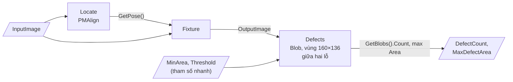

Cùng khung `Locate` như C1 (file `scripts/C2_defects.cs` có đủ cả lớp); phần riêng của `GroupRun`:

```csharp
    CogBlobTool defects = (CogBlobTool)mToolBlock.Tools["Defects"];
    defects.RunParams.ConnectivityMinPixels = (int)mToolBlock.Inputs["MinArea"].Value;
    defects.RunParams.SegmentationParams.HardFixedThreshold =
      (int)mToolBlock.Inputs["Threshold"].Value;
    defects.InputImage = part;
    if (!Step(defects, ref message, ref result)) { return false; }

    int count = 0;
    double maxArea = 0;
    if (defects.Results != null)
    {
      CogBlobResultCollection blobs = defects.Results.GetBlobs();
      count = blobs.Count;
      foreach (CogBlobResult blob in blobs)
      {
        if (blob.Area > maxArea) { maxArea = blob.Area; }
      }
    }
    mToolBlock.Outputs["DefectCount"].Value = count;
    mToolBlock.Outputs["MaxDefectArea"].Value = maxArea;
```

Điểm nối: hai **tham số nhanh** đi thẳng từ terminal input vào `RunParams` — kỹ sư kéo thanh trượt trên
bản nháp (Ch22) mà không mở job. Có lỗi = **Accept** với `DefectCount > 0`; NG do giới hạn
`upper: 0` trong `product.json` — job không tự phán định thứ MeoVision phán định được.

### 11.4 C3 — góc tấm cho robot (`C3_corner.vpp`, lệnh `Guide`)

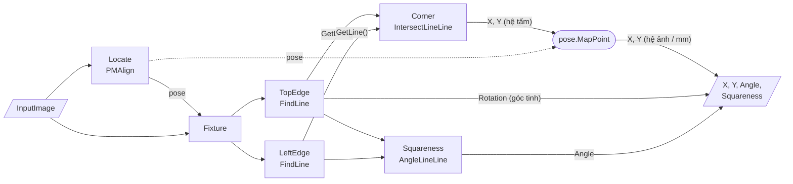

Đây là mẫu **thô → tinh** hay gặp nhất ở trạm dẫn robot: PMAlign cho tư thế thô (đủ để đặt vùng),
FindLine đo lại cạnh bằng 8 caliper cho góc tinh, giao hai cạnh cho **góc ảo** (điểm không có pixel nào
"là" nó), rồi đổi ngược ra hệ của ảnh vào — có hiệu chuẩn thì ra mm của máy. Phần riêng của `GroupRun`
(`scripts/C3_corner.cs`):

```csharp
    CogFindLineTool top = (CogFindLineTool)mToolBlock.Tools["TopEdge"];
    CogFindLineTool side = (CogFindLineTool)mToolBlock.Tools["LeftEdge"];
    CogIntersectLineLineTool corner = (CogIntersectLineLineTool)mToolBlock.Tools["Corner"];
    CogAngleLineLineTool square = (CogAngleLineLineTool)mToolBlock.Tools["Squareness"];

    top.InputImage = part;
    side.InputImage = part;
    if (!Step(top, ref message, ref result)) { return false; }
    if (!Step(side, ref message, ref result)) { return false; }
    CogLine topLine = Line(top);
    CogLine sideLine = Line(side);
    if (topLine == null)
    { return Reject("TopEdge: line not found", ref message, ref result); }
    if (sideLine == null)
    { return Reject("LeftEdge: line not found", ref message, ref result); }

    corner.InputImage = part;
    corner.LineA = topLine;
    corner.LineB = sideLine;
    if (!Step(corner, ref message, ref result)) { return false; }
    if (!corner.Intersects)
    { return Reject("Corner: edges do not intersect", ref message, ref result); }
    square.InputImage = part;
    square.LineA = topLine;
    square.LineB = sideLine;
    if (!Step(square, ref message, ref result)) { return false; }

    // Góc tấm đo trong hệ tấm → đổi ra hệ của ảnh vào bằng chính tư thế PMAlign (= phép biến
    // đổi Fixture đã dùng). Ảnh vào có hiệu chuẩn thì X/Y ra mm của máy.
    double x, y;
    mPose.MapPoint(corner.X, corner.Y, out x, out y);
    // Góc xoay: PMAlign cho góc THÔ; cạnh trên tìm bằng 8 caliper cho góc TINH trong hệ tấm.
    double edge = topLine.Rotation;
    while (edge > Math.PI / 2) { edge -= Math.PI; }
    while (edge <= -Math.PI / 2) { edge += Math.PI; }
    double squareness = Math.Abs(Degrees(square.Angle));
    if (squareness > 90) { squareness = 180 - squareness; }

    mToolBlock.Outputs["X"].Value = x;
    mToolBlock.Outputs["Y"].Value = y;
    mToolBlock.Outputs["Angle"].Value = Degrees(mPose.Rotation + edge);
    mToolBlock.Outputs["Squareness"].Value = squareness;
```

Lệnh này khai `"kind": "Guide"` trong `product.json`: MeoVision **không bao giờ bỏ qua** lệnh dẫn
hướng (DESIGN_LOG [29]) — robot không được nhận toạ độ giả.

### 11.5 Chạy trên máy có VisionPro

```bat
cd samples\toolchains
build.cmd
```

`build.cmd` biên dịch hai chương trình bằng Roslyn `csc` của VS2022 (tham chiếu mọi
`Cognex.VisionPro*.dll` trong `%VPRO_ROOT%\ReferencedAssemblies`, trừ 3D — cách của
`docs/ui/spike/README.txt`), dựng `jobs\C1_measure.vpp`, `C2_defects.vpp`, `C3_corner.vpp`, rồi chạy cả
8 ảnh qua từng job và in một dòng mỗi ảnh:

```
== C1_measure
ok_01.bmp          Accept     63.4 ms  Width=360.248 Height=180.236 Pitch=229.999 HoleDiameter=48.091  ok
ok_02.bmp          Accept      3.1 ms  Width=360.161 Height=180.017 Pitch=229.695 HoleDiameter=48.084  ok
ok_03.bmp          Accept      3.7 ms  Width=360.357 Height=179.982 Pitch=229.687 HoleDiameter=48.114  ok
ng_hole_07.bmp     Reject      4.1 ms  Width=- Height=- Pitch=- HoleDiameter=-  ok
                   message: HoleRight: hole not found
ng_long_08.bmp     Accept      4.1 ms  Width=380.312 Height=179.836 Pitch=229.979 HoleDiameter=48.105  ok

== C2_defects
ok_01.bmp          Accept     53.6 ms  DefectCount=0 MaxDefectArea=0  ok
ng_defect_05.bmp   Accept      7.4 ms  DefectCount=3 MaxDefectArea=112.956  ok

== C3_corner
ok_02.bmp          Accept      2.7 ms  X=185.272 Y=109.39 Angle=8.502 Squareness=89.955  ok
ok_03.bmp          Accept      3.5 ms  X=94.981 Y=209.396 Angle=-11.977 Squareness=89.936  ok
...
ALL MATCH
```

*(Trích đầu ra THẬT, VisionPro 9.0 CR2, 2026-11-03 — lần chạy đầu mỗi job 20–60 ms vì nạp/biên dịch
script, sau đó 3–7 ms. Job đo kích thước trả `Accept` cho ảnh dài 380 px: job chỉ ĐO, phán định OK/NG
theo giới hạn nằm ở `product.json` — mục 5.)* Dung sai so đáp án:
kích thước ±1 px, góc tấm ±1,5 px, góc xoay ±0,3°, độ vuông góc 90 ± 0,3°, số lỗi đúng tuyệt đối. Có
dòng `MISMATCH` → mã thoát 1: xem cột nào lệch rồi chỉnh tham số trong `MakeToolChainJobs.cs` (polarity,
hướng tìm, contrast) hoặc script. Hai chỗ đáng nghi nhất nếu lệch: **chiều tìm của FindLine** (+90° so
với Start→End) và **polarity** — cả hai đều có thể đảo mà không báo lỗi, chỉ là "không thấy cạnh".

### 11.6 Đưa vào MeoVision

1. Tạo `Data\products\P-2048\` — chép `samples/toolchains/product.json` vào, chép `jobs\*.vpp` vào
   `jobs\`. Bộ ảnh có nhãn của Thiết lập lệnh (Ch24) nằm theo **từng lệnh**:
   `samples\<mã lệnh>\OK|NG\` — cùng một ảnh có nhãn khác nhau theo lệnh:

   | Lệnh | `NG\` | `OK\` |
   |---|---|---|
   | M1 | `ng_hole_07` (Reject), `ng_long_08` (Width 380 > 362) | 6 ảnh còn lại (lỗi bề mặt không ảnh hưởng kích thước) |
   | M2 | `ng_defect_05`, `ng_defect_06` | 6 ảnh còn lại |
   | M3 | — | cả 8 ảnh (góc tấm vẫn tìm được, góc xoay trong ±20°) |
2. `machine.json` phải có camera vai trò `TopCam` và đèn `MainLight` (như `machine.example.json`);
   thử không camera: cho `TopCam` là camera thư mục trỏ vào `images`.
3. Đổi sang sản phẩm `P-2048`: `ProductLoader` kiểm từng job (output/tunable khai trong `product.json`
   có thật trong `.vpp`, đúng kiểu), báo đủ mọi lỗi một lần.
4. Có hiệu chuẩn: thêm `"calibration": "TopCal"` cho M1/M3 → Width/Height/Pitch ra mm, X/Y ra mm của
   máy; sửa `unit` và giới hạn trong `product.json` theo — **job không đổi**.

## 12. Ảnh chụp màn hình

### 12.1 Ảnh chụp VisionPro thật đang có (spike giao diện, 2026-10-16)

| Ảnh | Nội dung |
|---|---|
| `../ui/spike/shots/tbedit.png` | `CogToolBlockEditV2`: nối PMAlign → Fixture bằng link (mục 4) |
| `../ui/spike/shots/tbedit3.png` | Như trên, font mặc định, ẩn nút mở/lưu |
| `../ui/spike/shots/calib.png` | `CogCalibNPointToNPointEditV2` (mục 10.6) |
| `../ui/spike/shots/acq.png` | `CogAcqFifoEditV2` (mục 10.8) |
| `../ui/spike/shots/qbedit.png` | `CogJobManagerEdit` — QuickBuild nhúng |

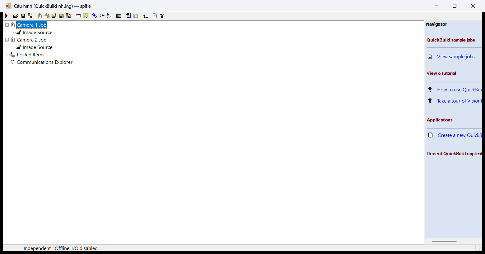

### 12.2 Ảnh chụp bằng `build.cmd shots` (2026-11-03)

`ToolShots.exe` nạp từng job, chạy trên `images\ok_03.bmp` (tấm xoay −12° — thấy rõ vùng đi theo), mở
editor V2 của từng tool rồi chụp (`PrintWindow`, như spike). Ra `docs/vision-tools/shots/`:

| Ảnh | Cho mục |
|---|---|
| `C1_measure_toolblock.png`, `C2_defects_toolblock.png`, `C3_corner_toolblock.png` | Cây tool + LastRun của cả job (11.2–11.4) |
| `C1_measure_Locate.png` | PMAlign: tab Train/Run, vùng train, kết quả (6.1) |
| `C1_measure_Fixture.png` | Fixture (6.2) |
| `C1_measure_Width.png`, `C1_measure_Height.png` | Caliper cặp cạnh trên ảnh ra Fixture (7.1) |
| `C1_measure_HoleLeft.png`, `C1_measure_HoleRight.png` | FindCircle (7.3) |
| `C1_measure_Pitch.png` | DistancePointPoint (9) |
| `C2_defects_Defects.png` | Blob: đốm lỗi, đốm bụi bị lọc (8.1) |
| `C3_corner_TopEdge.png`, `C3_corner_LeftEdge.png` | FindLine (7.2) |
| `C3_corner_Corner.png`, `C3_corner_Squareness.png` | IntersectLineLine, AngleLineLine (9) |

Tool nào VisionPro không có editor theo quy ước tên `Cog<Tên>EditV2` thì bị bỏ qua và ghi vào
`shots/toolshots_log.txt`. Lần chụp 2026-11-03: 16 ảnh tool (đã chèn vào mục 6–9); ảnh `*_toolblock.png`
không ra (log không ghi editor nào cho ToolBlock) — chưa tìm nguyên nhân; ảnh `CogToolBlockEditV2` thật
xem `../ui/spike/shots/tbedit.png` (mục 4).

## 13. Mẫu nối tool hay gặp khác

Các mẫu dưới đây dùng lại khung `Step`/`Reject`/`Locate` của ba script mẫu. *(chưa chạy)*

### 13.1 Nhiều chi tiết trên một ảnh — một Fixture cho mỗi kết quả PMAlign

Khay N chi tiết: PMAlign `ApproximateNumberToFind = N`, rồi lặp — mỗi kết quả gắn lại Fixture và chạy
lại tool đo. Đầu ra là số chi tiết đạt/hỏng hoặc chuỗi kết quả theo vị trí.

```csharp
    int bad = 0;
    for (int i = 0; i < locate.Results.Count; i++)
    {
      fixture.RunParams.UnfixturedFromFixturedTransform = locate.Results[i].GetPose();
      if (!Step(fixture, ref message, ref result)) { return false; }
      width.InputImage = (CogImage8Grey)fixture.OutputImage;
      if (!Step(width, ref message, ref result)) { return false; }
      if (width.Results == null || width.Results.Count == 0 ||
          Math.Abs(width.Results[0].Width - 360) > 2) { bad++; }
    }
    mToolBlock.Outputs["Found"].Value = locate.Results.Count;
    mToolBlock.Outputs["Bad"].Value = bad;
```

Lưu ý: `LastRun` của `width` chỉ còn lần chạy cuối — muốn record hiển thị đủ N chi tiết thì vẽ thêm đồ
hoạ trong `ModifyLastRunRecord`.

### 13.2 Hai giai đoạn: PMAlign thô cả ảnh → PMAlign tinh trong vùng nhỏ

Chi tiết nhỏ (dấu khắc, chân linh kiện) trên vật lớn: PMAlign 1 tìm vật (nhanh, PatQuick, cả ảnh),
Fixture, PMAlign 2 có `SearchRegion` khai trong hệ vật (nhỏ, PatMax) tìm chi tiết. Vùng tìm nhỏ → nhanh
và không bắt nhầm chi tiết giống ở chỗ khác.

### 13.3 Khoảng cách tâm lỗ – cạnh (độ lệch vị trí lỗ)

`FindCircle` (tâm lỗ) + `FindLine` (cạnh chuẩn) → `CogDistancePointLineTool`. Đây là cách đo "vị trí lỗ
so với cạnh" theo bản vẽ, không phụ thuộc tấm đặt lệch.

### 13.4 Hai camera, một lệnh

`product.json` khai `extraCameras` với `terminal` riêng (vd. `SideImage`); job có thêm input đó. Mỗi
ảnh có chuỗi tool riêng; script gộp kết quả (vd. chiều cao từ camera cạnh, vị trí từ camera trên). Hai
ảnh có hai cây hệ toạ độ khác nhau — chỉ so được kết quả của hai camera khi cả hai đã hiệu chuẩn về
cùng hệ máy (mm).

### 13.5 Tiền xử lý → Blob

Bề mặt có vân/xước mảnh làm Blob đếm sai: `CogIPOneImageTool` (mở hình thái học xám, nhân 3 × 3) **sau
Fixture**, rồi Blob trên ảnh ra của nó. Không đặt bộ lọc này trước Caliper/FindLine đo kích thước.

## 14. Lỗi hay gặp khi nối tool — danh sách kiểm

| # | Triệu chứng | Nguyên nhân | Cách sửa |
|---|---|---|---|
| 1 | Đo đúng ở ảnh train, sai dần khi sản phẩm lệch | Tool đo nhận ảnh gốc thay vì ảnh ra của Fixture | Mọi tool sau Fixture: `InputImage = fixture.OutputImage` |
| 2 | Không tìm thấy khi sản phẩm xoay vài độ | `ZoneAngle` để mặc định Nominal 0° | `LowHigh` ± góc lệch |
| 3 | Job báo Error khi thiếu chi tiết | Link `Results.Item[0]` trong khi tool trước 0 kết quả | Script kiểm `Count == 0` → Reject có lý do |
| 4 | Lệnh trả số của lần trước | Script chỉ gán output khi tìm thấy | MeoVision xoá output trước khi chạy; job nên Reject khi không gán |
| 5 | Vùng Blob đếm cả lỗ/rãnh | Vùng ôm chi tiết cố định của sản phẩm | Thu vùng; hoặc lọc Area/vị trí; hoặc vùng loại trừ |
| 6 | FindLine/Caliper "không thấy cạnh" dù cạnh rõ | Polarity ngược với hướng tìm (đổi chiều đoạn, xoay vùng 180°) | Vẽ hướng tìm trong editor, đặt lại polarity |
| 7 | Toàn bộ vùng lệch sau khi train lại PMAlign | Gốc mẫu (`Origin`) thay đổi | Đặt `Origin` bằng số cố định; train lại = kiểm lại cả bộ ảnh có nhãn (Ch24) |
| 8 | Góc robot lệch 180° thỉnh thoảng | Sản phẩm đối xứng, PMAlign khớp ngược | Chi tiết phá đối xứng trong vùng train; thu `ZoneAngle` |
| 9 | Số mm "lạ" sau khi bật hiệu chuẩn | Ngưỡng/`MinPixels` vẫn là pixel nhưng kết quả là mm/mm² | Tách rõ đơn vị: tham số đầu vào px, giới hạn đầu ra mm |
| 10 | Script compile lỗi trên máy khác | Thiếu assembly tham chiếu, hoặc dùng cú pháp C# > 5 | Tham chiếu kiểu `%VPRO_ROOT%` (như `MakeToolChainJobs.SetScript`); C# 5 |
| 11 | Mở job thì hiện hộp thoại và treo | Script hỏng → VisionPro hiện modal | Luôn nạp qua `ScriptDialogGuard` (DESIGN_LOG [18]) |
| 12 | Kết quả sai thỉnh thoảng khi hai camera dùng chung job | Một ToolBlock chạy trên hai luồng | `CogVisionJob` khoá theo job (đã có) — đừng gọi `Run()` trực tiếp từ chỗ khác |
